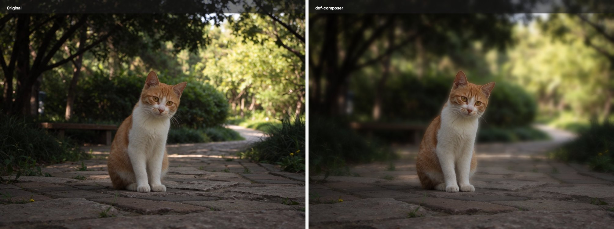

# dof-composer

用单目深度估计与主体分割，给一张**全焦照片**合成类似大光圈镜头的景深效果。



<sub>左：原图（背景清晰）｜右：合成后（主体保持锐利，背景按远近虚化）</sub>

<sub>样例图由 AI 生成。复现命令：`dof-composer docs/samples/cat_park.jpg -o out`</sub>

---

## 最快上手

装好环境和权重之后（见下方「安装」），一条命令：

```bash
dof-composer photo.jpg
```

结果会出现在 `out/` 目录里，**直接看 `dof_photo.png` 就是成品**。

就这一句，其他参数全都不用给。权重位置、输出目录、模型规格都有合理默认值。

处理整个文件夹：

```bash
dof-composer ./photos
```

想调背景糊的程度：

```bash
dof-composer photo.jpg --blur-sigma 20
```

---

## 它是怎么做的

两个预训练模型各负责一件事，然后把结果融合：

| 模型 | 输出 | 回答的问题 |
|---|---|---|
| [BiRefNet](https://github.com/ZhengPeng7/BiRefNet) | alpha 遮罩（0~1 软边） | 这个像素**是不是主体** |
| [Depth-Anything-V2](https://github.com/DepthAnything/Depth-Anything-V2) | 相对深度图 | 这个像素**有多远** |

融合成一个清晰度权重，再用它混合原图与模糊图：

```
weight = alpha + (1 - alpha) * depth
out    = original * weight + blurred * (1 - weight)
```

这个公式的设计意图：

- `alpha = 1`（确定是主体）→ `weight = 1`，强制清晰。深度信息被完全屏蔽，
  因为深度模型偶尔会把主体误判成远处，不屏蔽会导致主体边缘被糊掉。
- `alpha = 0`（确定是背景）→ `weight = depth`，按远近决定虚化程度，形成纵深。
- `alpha` 在中间（软边）→ 按比例插值，边缘过渡自然。

**核心思路是"alpha 优先保护主体，深度只负责背景内的层次"**，而不是两者平等加权。

---

## 安装

### 第 1 步 · 装本项目

```bash
git clone https://github.com/1Laurence/dof-composer.git
cd dof-composer
pip install -e .
```

### 第 2 步 · 装 PyTorch

`torch` 的 wheel 与 CUDA 版本绑定，由 pip 自动解析容易装错，因此本项目
**刻意不把它写进依赖**。按自己的环境装：

```bash
# 有 NVIDIA 显卡（CUDA 12.4）
pip install torch torchvision --index-url https://download.pytorch.org/whl/cu124

# 只有 CPU
pip install torch torchvision --index-url https://download.pytorch.org/whl/cpu
```

验证是否装对：

```bash
python -c "import torch; print(torch.cuda.is_available())"
```

有显卡应输出 `True`。

### 第 3 步 · 下载 Depth-Anything-V2 代码

```bash
git clone https://github.com/DepthAnything/Depth-Anything-V2.git
```

放在 `dof-composer/` 旁边或里面都行，程序会自动找到。

### 第 4 步 · 下载两个模型权重

**BiRefNet**（约 445MB）

从 https://huggingface.co/ZhengPeng7/BiRefNet 下载全部文件，放到：

```
dof-composer/models/BiRefNet/
```

国内网络慢可先设镜像：

```bash
export HF_ENDPOINT=https://hf-mirror.com        # Linux / macOS
set HF_ENDPOINT=https://hf-mirror.com           # Windows CMD
$env:HF_ENDPOINT="https://hf-mirror.com"        # Windows PowerShell
```

**Depth-Anything-V2 权重**

从 https://github.com/DepthAnything/Depth-Anything-V2 的 README 里
**Pre-trained Models** 表格下载 `depth_anything_v2_vitl.pth`，放到：

```
Depth-Anything-V2/checkpoints/depth_anything_v2_vitl.pth
```

### 第 5 步 · 确认能找到

```bash
dof-composer --help
```

然后在任意目录下跑一次真实图片，前几行会打印它找到的权重路径：

```
BiRefNet 权重：/path/to/models/BiRefNet
Depth-Anything-V2 仓库：/path/to/Depth-Anything-V2
深度权重：/path/to/checkpoints/depth_anything_v2_vitl.pth
```

三条都打印出来了，就说明配好了。若哪条报错，按错误提示里的路径放文件即可。

---

## 自动查找的规则

程序从**当前目录**开始，逐级向上找最多 4 层，命中以下任一位置就用：

| 找什么 | 会尝试的相对路径 |
|---|---|
| BiRefNet 权重 | `models/BiRefNet`、`weights/BiRefNet`、`checkpoints/BiRefNet` |
| Depth 代码仓库 | `Depth-Anything-V2`、`third_party/Depth-Anything-V2` |
| Depth 权重 | `<仓库>/checkpoints/depth_anything_v2_<encoder>.pth` |

判断依据不是“目录存在”，而是**关键文件存在**（BiRefNet 要有 `config.json`，
Depth 仓库要有 `depth_anything_v2/dpt.py`），避免认错一个空目录。

找不到时用参数显式指定：

```bash
dof-composer photo.jpg -w ./models/BiRefNet -d ./Depth-Anything-V2
```

---

## 用法详解

### 输出文件

每张输入图生成四个文件，都在 `out/` 下：

| 文件 | 内容 | 什么时候看它 |
|---|---|---|
| `dof_<name>.png` | **最终结果** | 平时只看这个 |
| `alpha_<name>.png` | 主体遮罩，白=主体 | 主体没被抠全时看 |
| `depth_<name>.png` | 深度灰度图，白=近 | 背景虚化层次不对时看 |
| `depth_colormap_<name>.png` | 深度伪彩图 | 同上，更容易分辨远近 |

### 参数

| 参数 | 默认值 | 说明 |
|---|---|---|
| `input` | 必填 | 输入图片或目录（唯一的必填项） |
| `-o, --outdir` | `out` | 输出目录，自动创建 |
| `-e, --encoder` | `vitl` | 深度规格：`vits` < `vitb` < `vitl` < `vitg`，越大越准也越慢 |
| `--blur-sigma` | `12` | 背景模糊强度，**想让背景更糊就调大** |
| `--depth-input-size` | `518` | 深度推理边长，调大细节更好但更慢 |
| `-w, --birefnet-weights` | 自动查找 | BiRefNet 权重目录 |
| `-d, --da2-root` | 自动查找 | Depth-Anything-V2 仓库根目录 |
| `-c, --da2-checkpoint` | 自动查找 | 深度权重 `.pth` 路径 |
| `--device` | 自动检测 | `cuda` 或 `cpu` |
| `-v, --verbose` | 关 | 输出详细日志 |

### 显存需求

两个模型**串行加载**：BiRefNet 跑完先卸载，再加载深度模型。
所以峰值只需容纳单个模型，而非两者之和。

实测（RTX 3050 Ti Laptop，4GB）：

| 阶段 | 显存峰值 |
|---|---|
| BiRefNet（1024×1024，fp32） | 3.12 GB |
| Depth-Anything-V2-Large（518） | 2.06 GB |

4GB 能跑但很紧。爆显存就换 `-e vits`（约 1GB）。

---

## 在代码里使用

不只有命令行。按你需要介入的深度，有三层用法。

### 第 1 层 · 只借合成公式（不需要模型，纯 numpy）

如果你已经有自己的 alpha 和深度图，只想用这个项目的合成逻辑：

```python
import cv2
import numpy as np
from dof_composer import compute_sharpness_weight, compose_depth_of_field

image = cv2.imread("photo.jpg")                     # BGR，uint8

# 关键：cv2.imread 读灰度图返回 uint8（0~255），必须转 float32 并归一化。
# 直接传 uint8 会让 alpha=255 处的 1-alpha 变成 -254，权重崩到 -6 万量级，
# 结果不是景深合成，而是一张高通残差图（边缘全是彩色噪点）。
# 新版会在入口直接报错拦截，但正确写法一开始就该这么写。
alpha = cv2.imread("alpha.png", cv2.IMREAD_GRAYSCALE).astype(np.float32) / 255.0
depth = cv2.imread("depth.png", cv2.IMREAD_GRAYSCALE).astype(np.float32) / 255.0

weight = compute_sharpness_weight(alpha, depth)      # (H, W)，1 = 保持清晰
result = compose_depth_of_field(image, weight, blur_sigma=12.0)

cv2.imwrite("out.png", result)
```

这一层**不 import torch**，装不装模型都无所谓，可以在纯 CPU 环境里跑。

> **两个输入都必须是 `float32`、值域 `[0, 1]`。** 这是最容易踩的坑。
> 8 位灰度图除以 255，16 位图除以 65535；深度模型（如 Depth-Anything）的原始输出
> 还要先做 min-max 归一化。传错时函数会抛 `ValueError` 并直接告诉你该怎么改。

### 第 2 层 · 用现成模型，换成自己的合成

想把两个模型当积木用，合成部分自己写：

```python
import cv2
import numpy as np
from PIL import Image
from pathlib import Path
from dof_composer import SubjectSegmenter, DepthEstimator

bgr = cv2.imread("photo.jpg")
pil = Image.open("photo.jpg").convert("RGB")

# --- 抠图 ---
seg = SubjectSegmenter("ZhengPeng7/BiRefNet", device="cuda")
alpha = seg.predict_alpha(pil)       # (H, W) float32, 0~1
seg.release()                        # 必须卸载，否则下一个模型装不下

# --- 深度 ---
est = DepthEstimator(
    encoder="vitl",
    checkpoint=Path("Depth-Anything-V2/checkpoints/depth_anything_v2_vitl.pth"),
    source_root=Path("Depth-Anything-V2"),
    device="cuda",
)
depth = est.normalize(est.predict_relative_depth(bgr, input_size=518))
est.release()

# --- 自己的合成规则：只虚化最远的 35% ---
# 注意：depth 是归一化后的**值**，不是**分位数**。
# 写 depth < 0.35 并不等于"最远的 35%"——实测在某张图上它覆盖了 60.6%。
# 想按面积比例来，必须用分位数取阈值。
threshold = float(np.quantile(depth, 0.35))

# 加 0.15 宽的过渡带，否则"清晰/模糊"之间会有一条看得出来的硬边
far = np.clip((threshold - depth) / 0.15, 0.0, 1.0)
weight = np.maximum(1.0 - far, alpha)      # 主体永远清晰

blurred = cv2.GaussianBlur(bgr, (0, 0), 9)
# 用 round 而不是直接 astype：astype 是截断，254.9 会变成 254
result = np.round(np.clip(
    bgr * weight[..., None] + blurred * (1 - weight[..., None]), 0, 255
)).astype("uint8")
```

完整可跑版本见 [`examples/custom_compose.py`](examples/custom_compose.py)，
支持 `--far-ratio`（按面积比例）与 `--threshold`（直接给阈值）两种用法。

这个例子的效果就是 `docs/samples/` 里那张猫图：
只让远处的书架和沙发糊掉，近处地板保持清晰，和默认的全深度虚化风格不同。

### 第 3 层 · 只用一个模型

`SubjectSegmenter` 和 `DepthEstimator` 互不依赖，可以单独用：

```python
# 只要抠图，不要景深
from dof_composer import SubjectSegmenter
seg = SubjectSegmenter("ZhengPeng7/BiRefNet", device="cuda")
alpha = seg.predict_alpha(pil)       # 拿去喂给你的抠图/合成流程

# 只要深度
from dof_composer import DepthEstimator
est = DepthEstimator("vits", ckpt, repo_root, device="cuda")
depth = est.normalize(est.predict_relative_depth(bgr, 518))
```

### API 一览

| 对象 | 说明 |
|---|---|
| `compose_depth_of_field(image_bgr, sharpness_weight, blur_sigma)` | 按权重混合原图与模糊图 |
| `compute_sharpness_weight(alpha, normalized_depth)` | 融合 alpha 与深度得清晰度权重 |
| `SubjectSegmenter(weights, device)` | BiRefNet 主体分割 |
| `DepthEstimator(encoder, checkpoint, source_root, device)` | Depth-Anything-V2 深度估计 |

`SubjectSegmenter.predict_alpha()` 接受 PIL Image，返回 `(H, W)` float32。
`DepthEstimator.predict_relative_depth()` 接受 BGR numpy 数组（这是上游模型的约定，
不是本项目选的），返回未归一化的原始深度；要 `[0, 1]` 就再调 `.normalize()`。

**注意**：两个类都要显式调用 `.release()` 释放显存。
4GB 显卡上不让前一个模型退场，后一个就加载不了。

---

## ⚠️ 模型权重许可

**本项目代码是 MIT，但模型权重不是。** 商用前务必读完本节。

| 组件 | 代码 | 权重 | 可否商用 |
|---|---|---|---|
| 本项目 | MIT | — | ✅ |
| BiRefNet | MIT | MIT | ✅ |
| Depth-Anything-V2 **Small** | Apache-2.0 | **Apache-2.0** | ✅ |
| Depth-Anything-V2 **Base/Large/Giant** | Apache-2.0 | **CC-BY-NC-4.0** | ❌ **禁止** |

换句话说：**默认的 `--encoder vitl` 只能非商业使用。**
需要商用请显式切到 Small：

```bash
dof-composer --input photo.jpg --encoder vits --da2-root ./Depth-Anything-V2
```

（`vits` 需另下 `depth_anything_v2_vits.pth`。）

程序在检测到非商用规格时会打印警告，但这只是提醒，不能代替你自己确认合规。

### 引用

```bibtex
@article{zheng2024birefnet,
  title={Bilateral Reference for High-Resolution Dichotomous Image Segmentation},
  author={Zheng, Peng and Gao, Dehong and Fan, Deng-Ping and Liu, Li and
          Laaksonen, Jorma and Ouyang, Wanli and Sebe, Nicu},
  journal={CAAI Artificial Intelligence Research},
  volume={3}, pages={9150038}, year={2024}
}

@article{depth_anything_v2,
  title={Depth Anything V2},
  author={Yang, Lihe and Kang, Bingyi and Huang, Zilong and Zhao, Zhen and
          Xu, Xiaogang and Feng, Jiashi and Zhao, Hengshuang},
  journal={arXiv:2406.09414}, year={2024}
}
```

---

## 项目结构

```
dof-composer/
├── pyproject.toml            # 打包配置、依赖、工具配置
├── src/dof_composer/         # 源码（src 布局，避免导入到未安装的本地包）
│   ├── __init__.py           # 公开 API 与版本号
│   ├── __main__.py           # 支持 python -m dof_composer
│   ├── config.py             # 常量与模型规格注册表
│   ├── paths.py              # 权重自动查找
│   ├── image_io.py           # 图片读写、路径收集
│   ├── segmenter.py          # BiRefNet 封装
│   ├── depth_estimator.py    # Depth-Anything-V2 封装
│   ├── composer.py           # 合成公式（核心）
│   └── cli.py                # 命令行入口
├── tests/
│   └── test_composer.py      # 合成公式的单元测试
└── docs/
    └── gaussian-blur-notes.md
```

**为什么用 src 布局**：如果源码直接放在仓库根目录，在仓库内运行 Python 时，
`import dof_composer` 会加载到当前目录的源码，而不是已安装的版本。
这会导致"本地能跑、装完反而坏"的诡异问题。加一层 `src/` 可以避免。

---

## 开发

```bash
pip install -e ".[dev]"

pytest              # 跑测试
ruff check .        # 代码检查
ruff format .       # 格式化
```

测试不加载任何模型，纯 numpy 运算，秒级完成。

---

## 已知限制

- **本质是合成，不是重打光。** 虚化只是对原图做高斯模糊，不模拟光圈叶片的
  形状（bokeh），也不会产生真实弥散圆。要更真实的效果需要 diffusion 类方法。
- **依赖 alpha 质量。** BiRefNet 对细结构（毛发、树叶、金属丝）会低估不透明度，
  导致边缘发虚。这是模型能力边界，调参数救不回来。
- **深度是相对的，不是物理距离。** Depth-Anything 只输出"谁比谁远"，
  没有绝对尺度，所以只用于相对虚化，不做真实光圈模拟。
- **速度快但精度有限。** 单张 3072×2048 约 5 秒（3050 Ti）。

## 环境

在 Windows 11 + RTX 3050 Ti Laptop (4GB) + Python 3.13 + torch 2.14.0+cu126 上验证通过。
理论支持 Python ≥ 3.10。

## 许可

代码：[MIT](LICENSE)。模型权重见上文「模型权重许可」一节。

`docs/samples/` 下的演示图由 AI 生成，仅作效果说明之用，不纳入 MIT 授权范围。